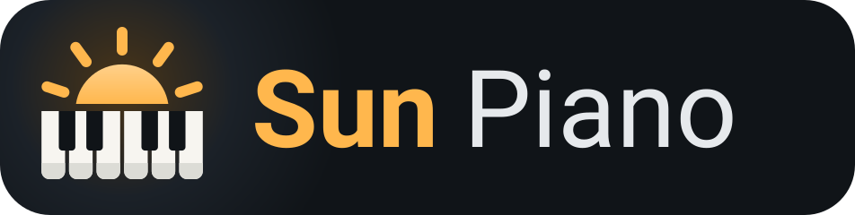

# Sun Piano

Electronic piano for Android (Kotlin, Jetpack Compose, Material 3). minSdk 26, targetSdk 36.

## Features
- 88-key keyboard with multitouch, glissando, touch-position velocity, note labels (letters or Do-Re-Mi), mini-map scrubber, octave shift, 7–28 visible keys
- Custom real-time synth (`audio/SynthEngine.kt`): 24-voice polyphony, band-limited wavetables + FM, ADSR, brightness envelope, detune/vibrato, sustain pedal, stereo reverb, soft limiter, low-latency float `AudioTrack`
- 8 synthesized instruments: Piano, Electric Piano, Honky-Tonk, Organ, Strings, Harpsichord, Marimba, Synth Lead
- Metronome with BPM, time signature, tap tempo, beat indicator
- Record / play back performances, rename, delete, export & share as Standard MIDI files
- USB and Bluetooth LE MIDI keyboard input (notes + sustain CC64); Bluetooth keyboards are found and connected in Settings; computer keyboard (Z–M = C3, Q–U = C4, Space = sustain)
- Transpose, tuning (A4 415–466 Hz), reverb, volume; all settings persisted with DataStore

## Build
    ./gradlew assembleDebug        # app/build/outputs/apk/debug/app-debug.apk
    ./gradlew testDebugUnitTest
    ./gradlew connectedDebugAndroidTest   # on a device: renders a demo passage to WAV

## Logo
An amber sun rising over piano keys, in the app's own colours. The `logo/` folder holds:
- `sun-piano.svg` and `sun-piano-512.png`: the icon on a rounded square (app stores, avatars)
- `sun-piano-wordmark.svg` and `.png`: icon and name on a dark panel
- `sun-piano-mono.svg`: one colour, for print

The app icon is an adaptive vector icon (`res/drawable/ic_launcher_*.xml`), with a one-colour layer for Android 13+ themed icons. The logo and icons are original artwork under the same license as the app.

## License
Copyright (C) 2026 alimiracle

Sun Piano is free software: you can redistribute it and/or modify it under the terms of the
GNU General Public License as published by the Free Software Foundation, either version 3 of
the License, or (at your option) any later version.

Sun Piano is distributed in the hope that it will be useful, but WITHOUT ANY WARRANTY; without
even the implied warranty of MERCHANTABILITY or FITNESS FOR A PARTICULAR PURPOSE. See the
[LICENSE](LICENSE) file for the full text of the GNU General Public License v3.
